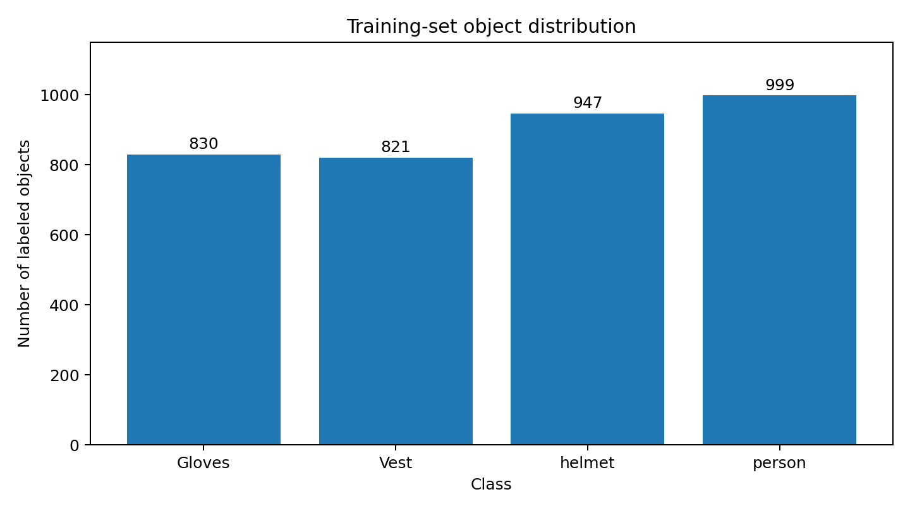

# PPE Detection using YOLOv8

A computer-vision project that detects four classes in images: **Gloves, Vest, helmet, and person**. This repository includes the Streamlit inference app, training and evaluation scripts, and an exploratory data analysis (EDA).

## Features
- Upload an image and run PPE object detection in Streamlit.
- Display bounding boxes, predicted classes, and confidence scores.
- Review detections and export results where supported by the app.
- Train a YOLOv8n baseline and evaluate it on a selected dataset split.

## Dataset
- **Dataset:** [PPE-Detection-with-Gloves, version 9 (Roboflow)](https://universe.roboflow.com/ppe-detection-82plm/ppe-detection-with-gloves)
- **Format:** YOLOv8
- **Classes:** Gloves, Vest, helmet, person
- **Images:** 501 train, 119 validation, 44 test (664 total)

Download/export the dataset from Roboflow in YOLOv8 format and extract it locally. The dataset is intentionally not stored in this repository.

Expected layout:
```text
PPE-Detection-with-Gloves-9/
├── data.yaml
├── train/images/  train/labels/
├── valid/images/  valid/labels/
└── test/images/   test/labels/
```
Check that the paths inside `data.yaml` point to the extracted folders.

## Exploratory Data Analysis (EDA)
Training-set labeled object counts:

| Class | Labeled objects |
|---|---:|
| Gloves | 830 |
| Vest | 821 |
| helmet | 947 |
| person | 999 |
| **Total** | **3,597** |



The class counts are reasonably close, so a large class-count imbalance is not an obvious explanation for weaker glove detection. Object size, visibility, occlusion, and image variety may also affect performance; the counts alone cannot establish the cause.

## Install dependencies
```bash
python -m venv .venv
source .venv/bin/activate
python -m pip install --upgrade pip
pip install -r requirements.txt
```

## Train the model
The baseline used YOLOv8n for 25 epochs at image size 640. `train.py` defaults to batch size 16; lower it if your hardware runs out of memory.

```bash
python train.py --data /path/to/PPE-Detection-with-Gloves-9/data.yaml
```
Replace the example path with the actual location of your dataset's `data.yaml`. The best weights are normally saved at `runs/ppe_baseline/train/weights/best.pt`.

## Evaluate the model
```bash
python evaluate.py --weights runs/ppe_baseline/train/weights/best.pt --data /path/to/PPE-Detection-with-Gloves-9/data.yaml --split test
```
The script prints precision, recall, mAP@50, mAP@50–95, and per-class AP@50.

### Previously recorded baseline metrics
| Metric | Test result |
|---|---:|
| Precision | 76.6% |
| Recall | 76.7% |
| mAP@50 | 80.0% |
| mAP@50–95 | 46.8% |

Recorded validation metrics were precision 87.6%, recall 79.5%, mAP@50 85.0%, and mAP@50–95 57.4%. Re-running training can produce slightly different results.

Recorded test mAP@50 by class: Gloves 54.3%, Vest 82.0%, helmet 93.7%, person 89.9%. Gloves were the weakest class in that run.

## Run the Streamlit app
Place your trained `best.pt` beside `app.py` if the app expects that filename, then run:
```bash
streamlit run app.py
```
The dataset and model weights are not committed to GitHub; download the dataset separately and supply the trained weights locally.

## Repository contents
```text
ppe-detection/
├── app.py
├── train.py
├── evaluate.py
├── requirements.txt
├── README.md
└── screenshots/
    ├── app-home.png
    ├── ppe-detection-results.png
    ├── detection-details.png
    └── class-distribution.png
```

## Limitations and next steps
Glove detection was weaker than the other classes in the recorded test results. Investigate object size, occlusion, image quality, and class-specific examples before attributing the gap to one cause. The model detects the trained visual classes; it does not independently determine full workplace PPE compliance.
