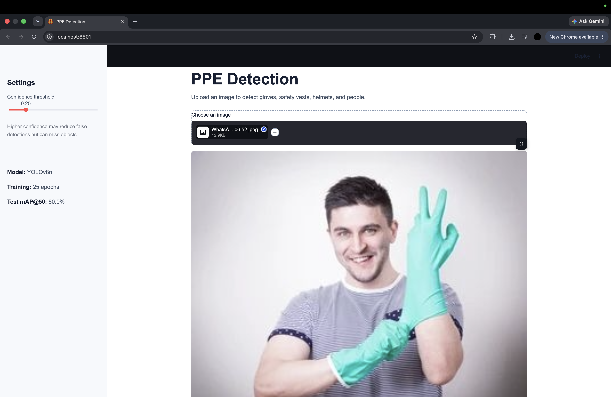
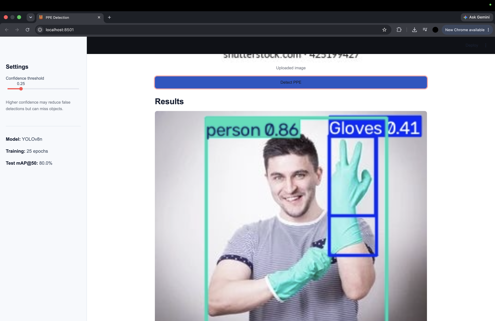
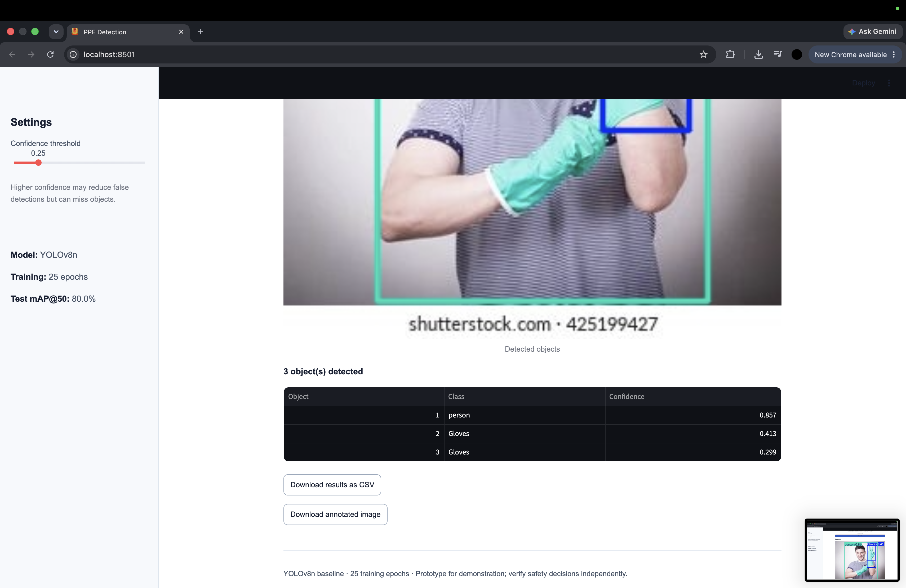

# PPE Detection

A clean, responsive Streamlit application that uses a custom-trained YOLOv8n model to detect **Gloves, Vest, helmet, and person** in uploaded images.

## Features
- Simple light interface with mobile-friendly layout
- JPG, JPEG, and PNG image upload
- Adjustable confidence threshold
- Annotated image with bounding boxes and labels
- Detection table with class and confidence
- Download detections as CSV or annotated PNG

## Model evaluation
Trained for 25 epochs on a Tesla T4 GPU. Held-out test set: 44 images and 270 labelled objects.

| Metric | Test score |
|---|---:|
| Precision | 76.6% |
| Recall | 76.7% |
| mAP@50 | 80.0% |
| mAP@50–95 | 46.8% |

Per-class mAP@50: Gloves 54.3%, Vest 82.0%, helmet 93.7%, person 89.9%.

**Limitation:** glove detection is weaker than the other classes. This is a baseline prototype, not a certified safety system; verify safety decisions with a qualified person.

## Files
```text
ppe-detection-app/
├── app.py
├── best.pt
├── requirements.txt
├── README.md
└── .gitignore
```
Place your trained `best.pt` in the same folder as `app.py`. The model file is not included in this package.

## Run locally
Python 3.10–3.12 is recommended for dependency compatibility.

```bash
python3 -m venv .venv
source .venv/bin/activate
python -m pip install -r requirements.txt
python -m streamlit run app.py
```

Open http://localhost:8501.

## Deploy
Push the files to GitHub, then use Streamlit Community Cloud to create an app from your repository with main file `app.py`. Test the deployed URL after the build completes.

Dataset: Roboflow Universe `ppe-detection-with-gloves`, version 9 (dataset page lists CC BY 4.0). Preserve attribution and check license terms before redistributing dataset material.

## Application Screenshots

### 1. Application Interface



### 2. PPE Detection Results



### 3. Detection Details


